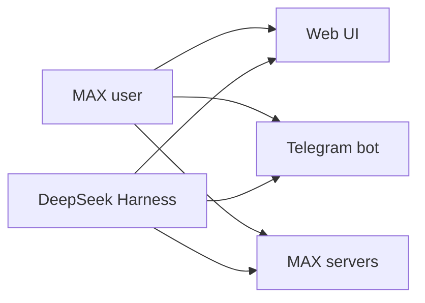
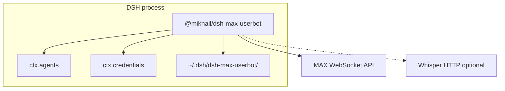
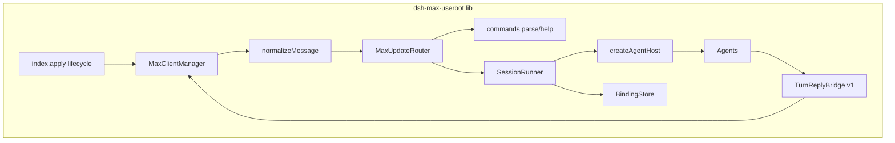
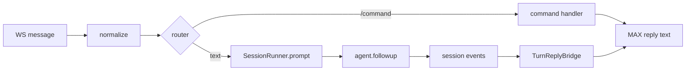
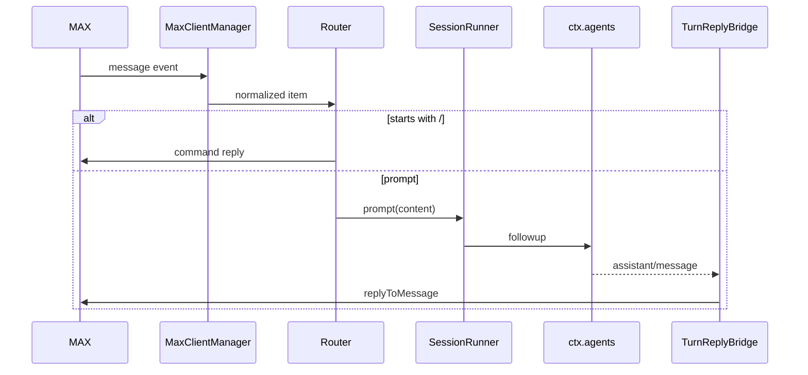
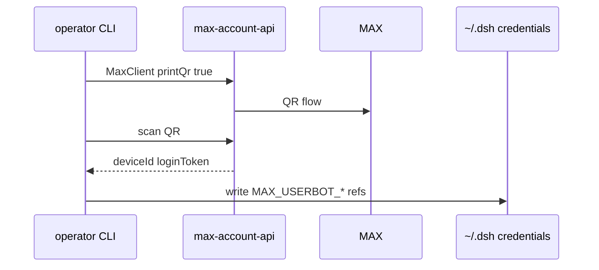
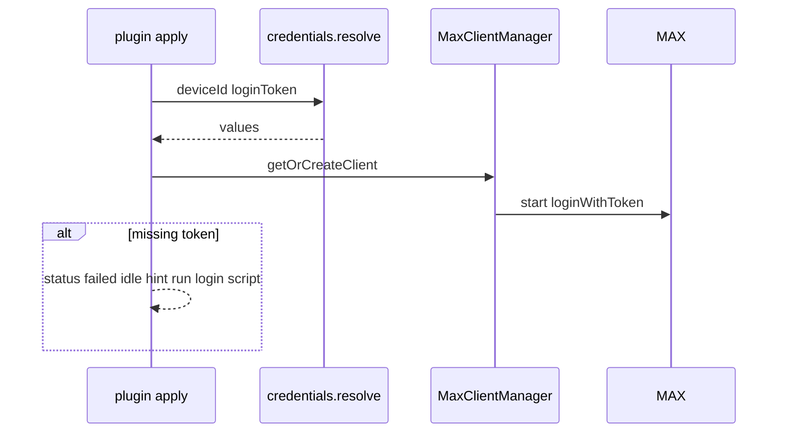

# Architecture Design: `@mikhail/dsh-max-userbot`

SSOT требований: [[repo/doc/plugins/dsh-max-userbot/tz]], [[repo/doc/plugins/dsh-max-userbot/research]].

**Что получаем (итог для заказчика):**

1. **Одно «ухо» MAX** — один `MaxClient` (WebSocket userbot) на инстанс DSH, слушает все входящие, один reconnect-loop.
2. **Slash-команды как в Telegram** — тот же набор `/help`, `/model`, `/cd`, `/new`, … (см. §ADR-002), обрабатываются **до** отправки текста агенту.
3. **Две сессии:** (A) учётка MAX — **один раз QR** (или phone) → `deviceId` + `loginToken` в credentials; (B) разговор с агентом — `chatId` → harness `sessionId`, `/new` как в TG.

---

## 1. Контекст системы (C4 — Level 1)

Пользователь пишет в MAX личному аккаунту (userbot). DSH держит постоянное соединение, будит того же агента, что Web/Telegram.

---

## 2. Контейнеры (C4 — Level 2)

---

## 3. Компоненты (C4 — Level 3)

---

## 4. Потоки данных (DFD)

---

## 5. Диаграмма последовательности

### 5.1 Обычное сообщение

### 5.2 Первичный login (вне DSH)

### 5.3 Старт DSH (silent login)

---

## 6. Архитектурные решения (ADR)

### ADR-001: Одно «ухо» MAX на процесс DSH

- **Статус:** Accepted
- **Контекст:** Несколько WS на одну учётку MAX конфликтуют; TZ — одна учётка на инстанс.
- **Решение:** Один `credentialsId` (= `deviceId`), один entry в `MaxClientManager`, один `onMessage` handler в `apply`.
- **Последствия:** Масштабирование только вторым процессом DSH + второй сессией MAX (out of scope). Простой reconnect.

### ADR-002: Slash-команды — паритет с `dsh-telegram`

- **Статус:** Accepted (расширяет TZ §4: команды **входят** в реализацию)
- **Контекст:** Заказчик хочет `/model`, `/help`, `/cd`, … как у TG-бота.
- **Решение:**
  - Вынести **общий** `COMMANDS`, `parseCommand(text)` без `@bot` (опциональный `@` игнорировать) в `plugins/dsh-max-userbot/lib/commands.js` — **копия контракта** из `dsh-telegram/lib/commands.js` (DRY позже, не блокер v1).
  - `MaxUpdateRouter` копирует **порядок** telegram router: access → command → prompt.
  - Обработчики команд **делегируют** тем же концептам, что telegram: `runner.reset`, `workspaces`, `model` seam, `PermissionControl` — через **узкий shared internal API** или дублирование минимальных адаптеров в MAX-плагине (v1: дублировать логику из router switch, не тянуть весь telegram пакет).
- **Фазы команд:**

| Фаза | Команды |
|------|---------|
| **v1.0 (MVP)** | `start`, `help`, `new`, `cd`, `model`, `status`, `stop`, `whoami` |
| **v1.1** | `effort`, `vision`, `permission`, `sessions` |
| **v1.2** | `diag`, `screenshot` (если хост с GUI/разрешён shell) |
| **Особый** | `claim` — **не** как у бота; для userbot вместо этого `allowFrom` + `owner.json` (см. ADR-004) |

- **Последствия:** Больше кода, чем «только текст»; нужны тесты на `parseCommand` + каждый handler. Ответы в MAX — **plain text** (без Telegram HTML); help форматируется markdown-lite или plain списком.

### ADR-003: QR только вне production loop

- **Статус:** Accepted
- **Контекст:** QR в systemd зависает процесс, непригоден для headless restart.
- **Решение:** `plugins/dsh-max-userbot/scripts/max-userbot-login.mjs` — `printQr: true`, stdout печатает пары для `~/.dsh/.credentials.yaml`. Плагин: `printQr: false`, при отсутствии token — `status.json` + log «run login script», **не** открывать QR.
- **Последствия:** Оператор один раз логинится вручную; ротация token — повторный скрипт.

### ADR-004: Доступ (whitelist телефонов) и harness-session

- **Статус:** Accepted
- **Контекст:** Userbot — личный аккаунт; писать могут многие контакты MAX. Нужен **whitelist разрешённых номеров** (как у заказчика), не «все входящие».
- **Решение:**
  - **Harness session:** `~/.dsh/dsh-max-userbot/bindings.json` — ключ `chatId` (v1 без thread).
  - **AuthZ (основной):** `config.allowPhones: string[]` — номера в формате **E.164** (`+79001234567`) или только цифры; при проверке нормализовать к цифрам (без `+`, пробелов).
  - **Проверка на сообщении:** для `fromId` вызвать `MaxClient.getContactInfo(fromId)` (кэш `fromId → phone` на диске в `~/.dsh/dsh-max-userbot/phone-cache.json`); сравнить `ContactInfo.phone` (number в API) с whitelist. Нет телефона в contact → **отклонить**, если `fromId` не в доп. списке.
  - **AuthZ (доп.):** `allowFrom: number[]` — явные MAX user id (обход, сервисные аккаунты, пока телефон не подтянулся).
  - **Пустой whitelist:** `allowPhones: []` и пустой `allowFrom` → **никто** не проходит (fail closed). Старт с непустым списком в `cordis.patch.yml`.
  - Команда `/whoami` — показывает `fromId` и телефон (если известен), чтобы оператор мог добавить номер в patch.
- **Последствия:** Лишний API-вызов на первое сообщение с нового `fromId`; кэш снижает нагрузку. Оператор правит whitelist в конфиге профиля, не в git с секретами.

### ADR-005: Ответ агента v1 — TurnReplyBridge (без streaming edit)

- **Статус:** Accepted
- **Контекст:** MAX нет edit-message streaming как TG; TZ v1 без streaming.
- **Решение:** Подписка на session events; на `assistant/message` (или end of turn) — один `replyToMessage` с chunking по `reply.maxChars`.
- **Последствия:** Длинные ответы — несколько сообщений подряд; typing indicator — v2.

### ADR-006: TypeScript → JavaScript

- **Статус:** Accepted
- **Контекст:** `features/max-userbot` — TS; плагины форка — ESM JS.
- **Решение:** Порт transport/normalize в `.js` в `plugins/.../lib/`; vendor остаётся с **prebuilt `dist/`** (`npm run build` в vendor при CI/разработке). Не тянуть `tsc` в runtime DSH.
- **Последствия:** Двойное сопровождение при изменении `features/` — синхронизировать вручную до общего пакета.

---

## 7. Чистая архитектура (границы)

| Слой | Содержимое |
|------|------------|
| **Domain** | Conversation key (`chatId`), command names, normalized inbound message |
| **Use cases** | HandleCommand, HandlePrompt, BindSession, DeliverReply |
| **Adapters** | MaxClientManager, credentials, filesystem bindings, Whisper download |
| **Framework** | Cordis `apply`, `ctx.agents`, `ctx.effect` |

---

## 8. План тестирования

| Тип | Сценарии |
|-----|----------|
| Unit | `parseCommand`, `normalizeMessage`, command handlers (mock runner), chunking reply |
| Unit | `MaxClientManager` (из `features/max-userbot/__tests__`, перенос) |
| Integration | self-skip: real MAX env vars |
| Manual | QR script → credentials → DSH start → `/help` → text → reply; `/new` → новый session id |

**Coverage:** ≥ **80%** `plugins/dsh-max-userbot/lib/**` (без `vendor/**`).

---

## 9. Безопасность

- Credentials только через `ctx.credentials.resolve`; login token в `SecretRegistry`.
- **`allowPhones`** обязателен для production (непустой whitelist); `allowFrom` — опциональное дополнение.
- Скачивание `voiceUrl`: size cap, timeout, HTTPS only.
- Логи без token/raw key.
- Команды не выполняют shell сами по себе — только через агента (как telegram).

---

## 10. Риски и компромиссы

- Дублирование command/router логики с telegram до выделения shared package.
- `screenshot` может быть no-op на headless сервере.
- Userbot ToS / ban risk.
- Полный паритет TG (approvals, streaming) — v2+.

---

## 11. Implementation checklist (для Plan Mode)

1. Собрать `plugins/dsh-max-userbot/package.json`, `cordis.patch.yml`, schemastery `Config`.
2. Порт `features/max-userbot` → `lib/transport`, `lib/normalizeMessage.js`, `lib/vendor`.
3. `scripts/max-userbot-login.mjs` + README оператора.
4. `lib/index.js`: credentials, `MaxClientManager`, effect lifecycle, `status.json`.
5. `lib/session/bindings.js`, `lib/session/runner.js`, `lib/harness/host.js`, `lib/harness/message.js` (по образу telegram, урезано).
6. `lib/access.js` — `PhoneWhitelistPolicy` (normalize phone, cache, `getContactInfo`).
7. `lib/commands.js`, `lib/router.js` — v1.0 command set (router: access до command).
8. `lib/reply/turn-bridge.js` — доставка ответа.
9. `test/` — unit перенос + access whitelist + router/command tests.
10. Обновить `plugins/README.md`, `doc/.../runbook-local.md` (после smoke).
11. Профиль `~/.dsh` — bundle + patch (вручную оператором).
