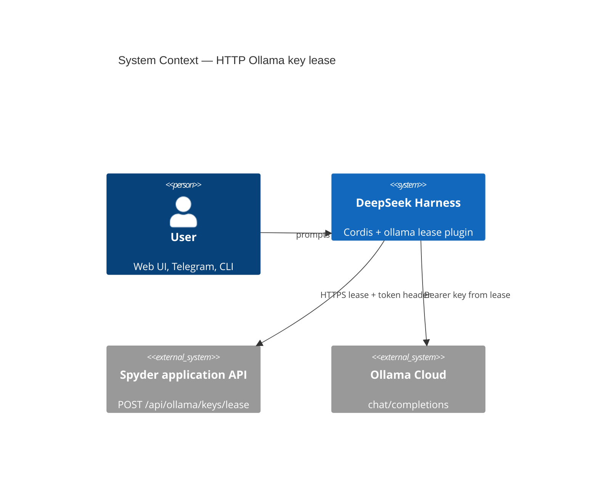
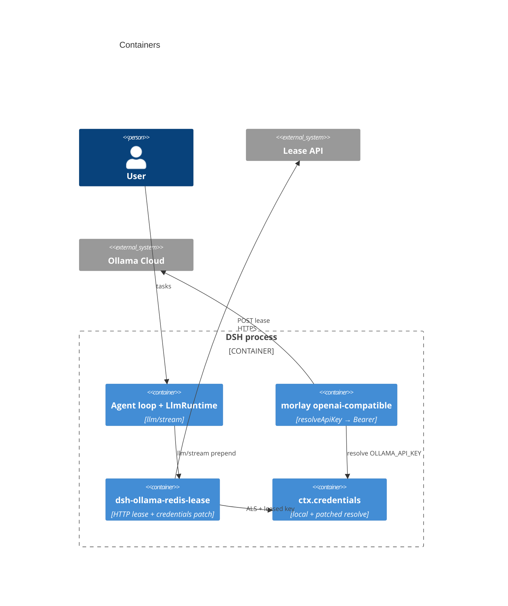
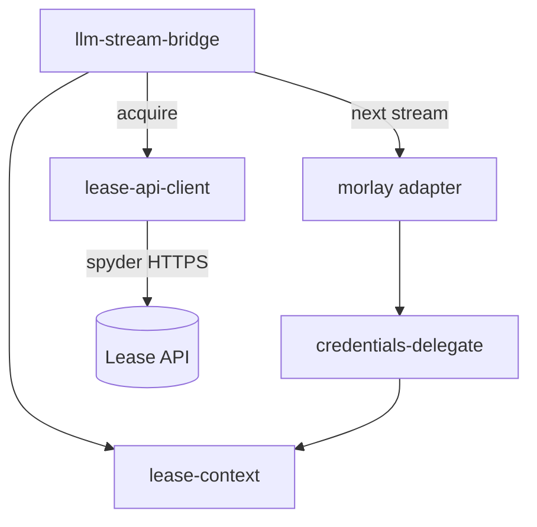
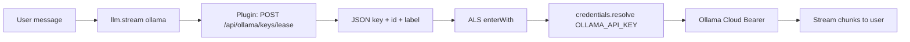
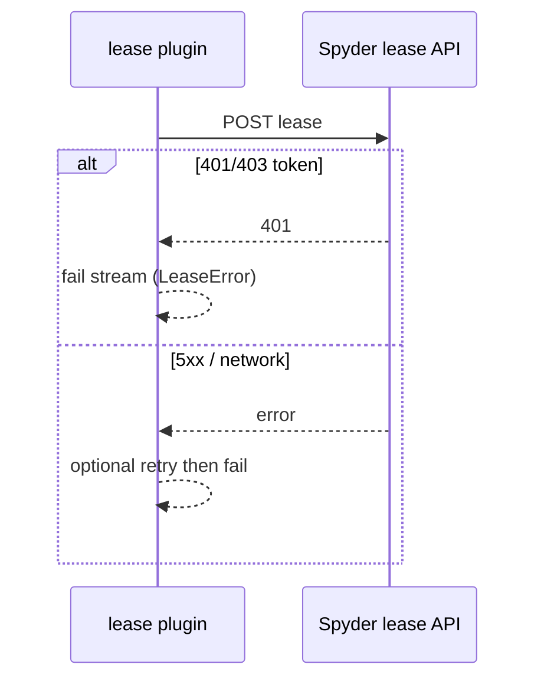

# Architecture Design: Ollama HTTP key lease для DSH

Пакет по-прежнему **`@mikhail/dsh-ollama-redis-lease`** (путь `plugins/dsh-ollama-redis-lease/`); семантика — **HTTP lease**, без Redis в процессе DSH. SSOT требований: [[repo/doc/plugins/dsh-ollama-redis-lease/research]] (актуальный); `tz.md` обновить отдельным коммитом под этот design.

## 1. Контекст системы (C4 — Level 1)

Пользователь обращается к DeepSeek Harness. Для маршрута LLM **`ollama`** DSH перед вызовом Ollama Cloud запрашивает ключ у **application-сервера** (spyder). Сервер владеет пулом, lock и политикой выдачи; DSH — HTTP-клиент lease.



## 2. Контейнеры (C4 — Level 2)



Redis и прочие хранилища ключей — **внутри** контейнера spyder, вне диаграммы DSH.

## 3. Компоненты (C4 — Level 3)

| Модуль (целевой `lib/`) | Слой | Ответственность |
|-------------------------|------|-----------------|
| `index.js` | Composition | `Config`, `apply`, `inject`, `ctx.effect` disposer |
| `lease-api-client.js` | Adapter | `POST` lease, parse JSON, ошибки wire |
| `lease-context.js` | Port | ALS: активный `{ id, label, secret }` |
| `credentials-delegate.js` | Adapter | `patchCredentialsResolve` (без изменений контракта) |
| `llm-stream-bridge.js` | Use case | На `ollama` stream: acquire → ALS → `next()` → **без** release/quarantine |
| `errors.js` | Domain | `LEASE_HTTP_ERROR`, `LEASE_INVALID_RESPONSE`, `LEASE_TOKEN_MISSING` |

**Удалить / не использовать:** `redis-pool.js`, зависимость `ioredis`.



## 4. Потоки данных (DFD)



Нет ветки «release в Redis» / «quarantine HASH».

## 5. Диаграмма последовательности (Sequence)

### 5.1 Успешный запрос

```mermaid
sequenceDiagram
  participant U as User
  participant L as LlmRuntime
  participant P as lease plugin
  participant S as Spyder lease API
  participant C as credentials patch
  participant M as morlay adapter
  participant O as Ollama Cloud

  U->>L: turn / chat
  L->>P: llm/stream waterfall
  P->>S: POST /api/ollama/keys/lease<br/>X-Ollama-Lease-Token
  S-->>P: 200 { id, key, label, lock_seconds, ... }
  P->>P: ALS enterWith lease
  P->>M: next() stream
  M->>C: resolve(OLLAMA_API_KEY)
  C-->>M: { value: key }
  M->>O: Authorization Bearer
  O-->>M: SSE chunks
  M-->>P: chunks
  P-->>L: chunks
  Note over P,S: v1: no HTTP release; server lock expires per lock_seconds
```

### 5.2 Lease failed



### 5.3 Не-ollama провайдер

Bridge вызывает `yield* next()` без HTTP lease (как сейчас).

## 6. Архитектурные решения (ADR)

### ADR-001: Acquire только через HTTP lease API

- **Статус**: Accepted (заменяет Redis ADR-002 прежнего design)
- **Контекст**: Оператор выдаёт ключи через spyder; DSH не имеет доступа к Redis-пулу и не должен дублировать lock/quarantine.
- **Решение**: На каждый `llm/stream` с `provider === llmProviderId` (default `ollama`) — один `POST` на configurable `lease.baseURL` + path (default `/api/ollama/keys/lease`). Заголовок `X-Ollama-Lease-Token` из `lease.tokenEnv` через `launchEnvironmentOf` / credentials.
- **Последствия**: Зависимость от доступности spyder; нужны timeout и понятные ошибки в логах.

### ADR-002: Без release и карантина в DSH (v1)

- **Статус**: Accepted
- **Контекст**: Сервер гарантирует валидный ключ и эксклюзивную выдачу; следующий запрос — новый POST lease.
- **Решение**: После окончания stream **не** вызывать release endpoint (если появится в API — v2). **Не** реализовать quarantine и **не** ветвить cleanup по HTTP status Ollama для пула (опционально только лог `id` при ошибке Ollama).
- **Последствия**: `llm-stream-bridge` упрощается: `try/finally` без `pool.release/quarantine`. Удалить `quarantine` из Config.

### ADR-003: Интеграция harness — `llm/stream` + ALS + patch resolve

- **Статус**: Accepted (без изменений по смыслу)
- **Решение**: Сохранить `prepend: true`, `enterActiveLease` до `for await (next())`, `patchCredentialsResolve` с `source: 'ollama-http-lease'` (или сохранить старый source string для меньшего diff — на усмотрение implement).
- **Последствия**: Параллельные ollama-streams — параллельные POST lease; сервер обязан выдавать разные ключи.

### ADR-004: HTTP-клиент — native `fetch`

- **Статус**: Accepted
- **Решение**: Node `fetch`; `Content-Type` по контракту сервера (пустое тело POST или `{}` — уточнить при первом интеграционном smoke; default empty body). Config: `timeoutMs`, `acquireRetries`, `acquireRetryDelayMs` для 5xx/сети (не для 401 token).
- **Последствия**: Убрать `ioredis` из `package.json`.

### ADR-005: Конфигурация и секреты

- **Статус**: Accepted
- **Решение**: schemastery `Config`: `lease.baseURL` (например `https://spyder-10.lighthouselabs.online`), `lease.path`, `lease.tokenEnv` (например `OLLAMA_LEASE_TOKEN`), `lease.tokenHeader` default `X-Ollama-Lease-Token`; `provider.credentialRef` default `OLLAMA_API_KEY`; `llmProviderId` default `ollama`; `allowStaticFallback` default `false`. **Нет** `redis.*`, `pool.*`, `quarantine.*`.
- **Последствия**: Обновить `cordis.patch.yml` пример в пакете.

### ADR-006: Ответ lease — минимальный контракт

- **Статус**: Accepted
- **Решение**: Успех: HTTP 2xx, JSON с непустой строкой `key`; опционально сохранять `id`, `label` для логов. Игнорировать для логики DSH: `is_active`, `locked_until`, `lock_seconds` (информативно для ops / debug log только `lock_seconds`).
- **Последствия**: Если сервер изменит имена полей — версионирование API или mapping в client.

## 7. Границы (чистая архитектура)

| Слой | Содержимое |
|------|------------|
| Domain | Правила «валидный lease», коды ошибок |
| Use case | Один ollama stream → один HTTP acquire |
| Ports | `LeaseApiClient.acquire(): Promise<Lease>` |
| Adapters | fetch, Cordis events, credentials patch |
| Composition | `apply()` |

## 8. План тестирования

| Тип | Сценарии |
|-----|----------|
| Unit | `lease-api-client`: 200 + JSON; отсутствует `key`; 401; 5xx + retry; timeout |
| Unit | `llm-stream-bridge`: acquire once per stream; non-ollama skip; ошибка lease не вызывает Ollama |
| Unit | `credentials-delegate`: без изменений набора кейсов |
| Integration | self-skip без `OLLAMA_LEASE_TEST_URL` + `OLLAMA_LEASE_TOKEN` |
| Регрессия | `npm test` в пакете; профиль `dsh --dump-config` после обновления patch |

**Coverage:** ≥ **80%** строк `lib/**` после переписывания.

## 9. Безопасность

- Token и `key` только из env/credentials; не в репозитории.
- Логи: `lease id`, `label`, duration; never `key` / token.
- TLS: стандартная проверка сертификата Node `fetch` (валидный HTTPS на `lease.baseURL`).
- Нет пользовательского ввода в URL lease (только config).

## 10. Риски и компромиссы

| Риск | Митигация |
|------|-----------|
| Долгий stream > `lock_seconds` | Ответственность сервера / TTL; README: типичная длительность < lock |
| Нет release — ключ «занят» до TTL при обрыве | Принято v1; server-side lock expiry |
| Имя пакета «redis-lease» | Документация; опциональное переименование позже |
| Старый Redis-код в git | Удалить в implement PR, не смешивать с HTTP |

## 11. Implementation checklist

1. Добавить `lib/lease-api-client.js`; удалить `redis-pool.js`; убрать `ioredis`.
2. Упростить `llm-stream-bridge.js` (только acquire + stream, без cleanup к API/Redis).
3. Переписать `lib/index.js` Config и wiring.
4. Обновить `cordis.patch.yml`, `README.md`, `plugins/README.md` (описание HTTP, не Redis).
5. Переписать тесты + mock fetch; удалить `test/mock-redis.js` или заменить на mock HTTP.
6. Обновить `tz.md` под HTTP (отдельная задача, синхрон с implement).
7. Пометить `final-review-report.md` устаревшим или перезапустить review после implement.

## Открытые вопросы (не блокируют старт v1)

| # | Вопрос | Default v1 |
|---|--------|------------|
| 1 | Тело POST (empty vs JSON)? | `POST` без body, `Accept: application/json` |
| 2 | Есть ли позже `DELETE /lease/{id}`? | Не вызывать |
| 3 | Переименовать пакет в `dsh-ollama-http-lease`? | Оставить имя npm для меньшего churn профиля |
