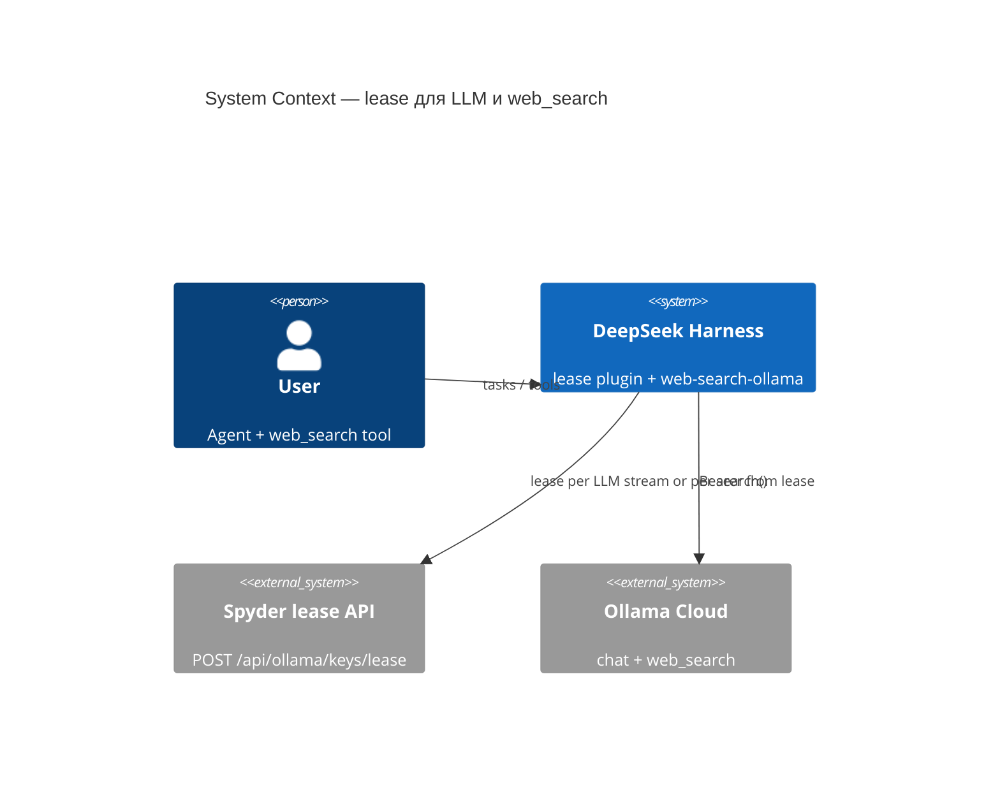
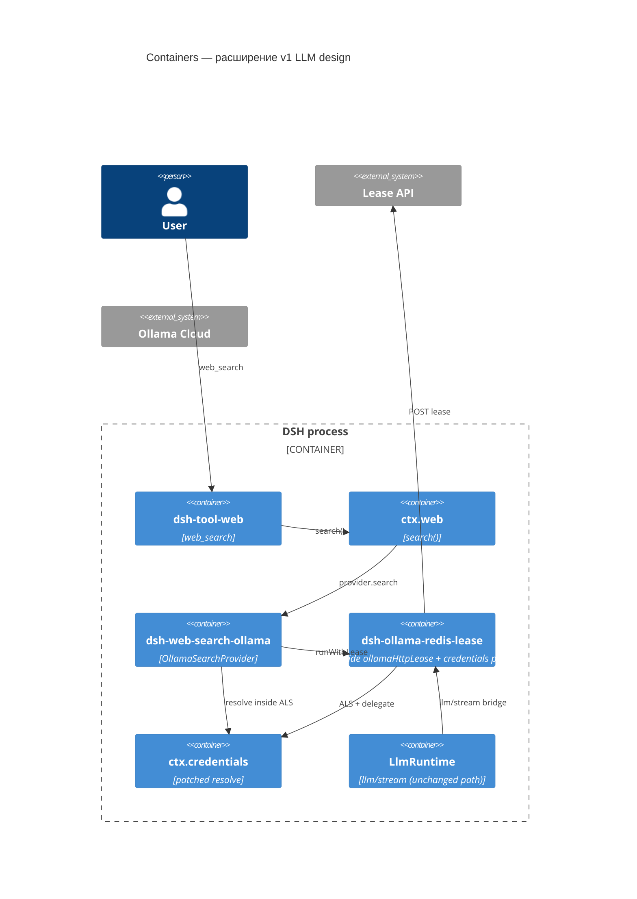
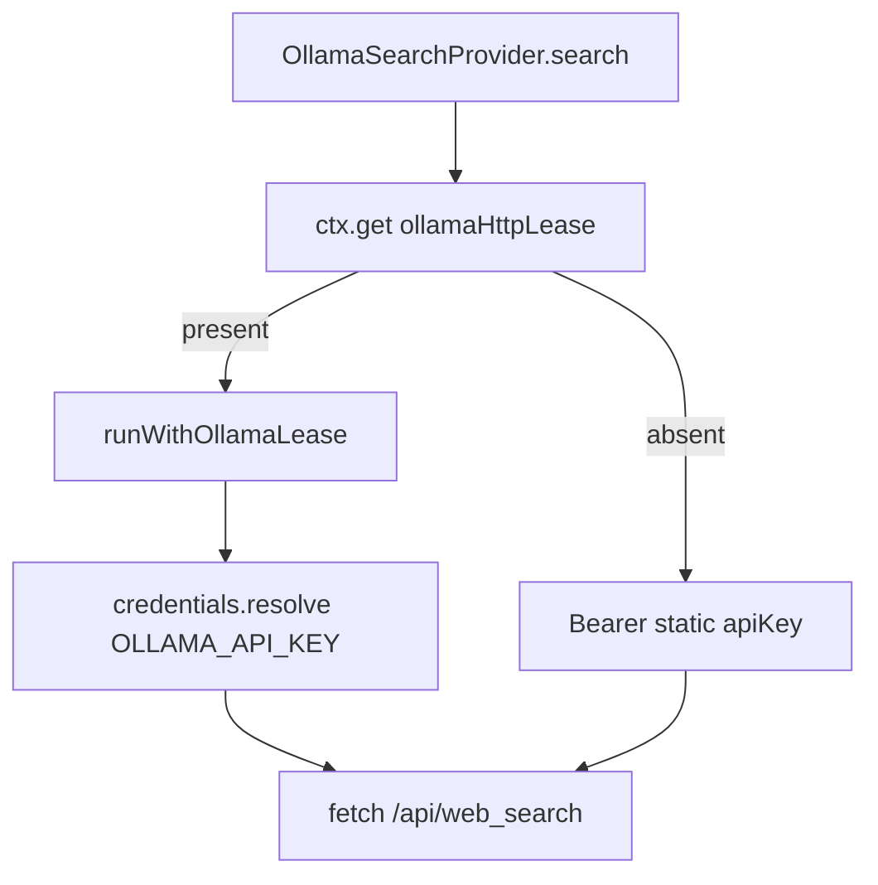
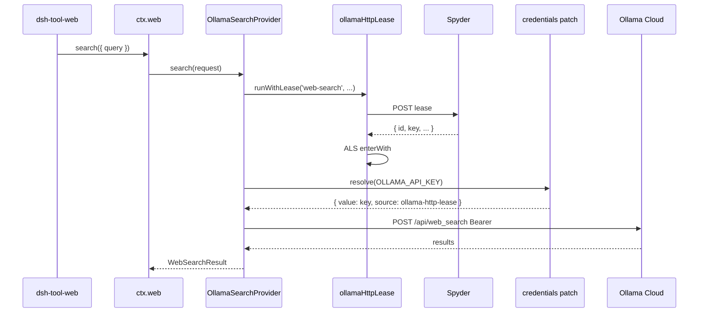

# Architecture Design: Ollama HTTP lease для `web_search`

SSOT требований: [[repo/doc/plugins/dsh-ollama-redis-lease/web-search-lease/research]]. Базовый lease для LLM: [[repo/doc/plugins/dsh-ollama-redis-lease/design]]. Пакеты: `@mikhail/dsh-ollama-redis-lease`, `@mikhail/dsh-web-search-ollama`. Upstream `packages/web` **не меняем**.

## 1. Контекст (C4 — Level 1)

Пользователь вызывает инструмент `web_search` (`@deepseek-ai/dsh-tool-web` → `ctx.web.search()`). При `searchProvider: ollama` запрос уходит в Ollama Cloud `POST /api/web_search` с Bearer. Ключ должен приходить из того же **HTTP lease** на Spyder, что и для LLM `ollama`, без отдельного статического `OLLAMA_API_KEY` в `.env`.



## 2. Контейнеры (C4 — Level 2)



## 3. Компоненты

### 3.1 `@mikhail/dsh-ollama-redis-lease` (изменения)

| Модуль | Действие |
|--------|----------|
| `lib/lease-scope.js` | **NEW** — `runWithOllamaLease({ leaseClient, logger, operation }, fn)` |
| `lib/llm-stream-bridge.js` | Вызывает `runWithOllamaLease` вместо inline acquire/ALS |
| `lib/index.js` | `ctx.provide('ollamaHttpLease', service)` + существующий credentials/llm wiring |

**Не добавлять:** отдельный HTTP-клиент в web-search; дублирование `patchCredentialsResolve`.

### 3.2 `@mikhail/dsh-web-search-ollama` (изменения)

Исходники переносятся в `plugins/dsh-web-search-ollama/lib/` (сейчас только README в git; runtime — `file:` dep).

| Модуль | Действие |
|--------|----------|
| `lib/index.js` | `inject: ['web', 'credentials']`; `ctx.get('ollamaHttpLease')`; регистрация провайдера с deps |
| `lib/provider.js` | Per-`search()` ключ: lease scope + `resolveApiKey` или legacy static `apiKey` |



## 4. Контракт сервиса `ollamaHttpLease`

Имя слота Cordis: **`ollamaHttpLease`** (стабильное, как `telegramStt`).

```javascript
/**
 * @typedef {'llm-stream' | 'web-search'} OllamaLeaseOperation
 */

/**
 * @typedef {object} OllamaHttpLeaseService
 * @property {(operation: OllamaLeaseOperation, fn: () => Promise<T>) => Promise<T>} runWithLease
 * Acquire HTTP lease, enter ALS, run fn, log finish (no HTTP release v1).
 * @property {() => boolean} isLeaseConfigured
 * True when lease token is non-empty (local check, no network).
 */
```

Регистрация в `apply()` lease-плагина:

```javascript
const service = {
  isLeaseConfigured: () => Boolean(launchEnvironmentOf(ctx).get(tokenEnv)?.value),
  runWithLease: (operation, fn) =>
    runWithOllamaLease({ leaseClient, logger: ctx.logger, operation }, fn),
}
ctx.provide('ollamaHttpLease', service)
```

Потребление в web-search (без `inject: ['ollamaHttpLease']` — опциональная зависимость):

```javascript
const ollamaHttpLease = ctx.get('ollamaHttpLease')
```

Как у voice/telegram: bundle **lease-плагина раньше** web-search, иначе `get` вернёт `undefined` и останется legacy env.

## 5. Потоки данных

### 5.1 Успешный `web_search`



### 5.2 Multi-query в одном tool call

`dsh-tool-web` может вызвать `ctx.web.search()` до `searchMaxQueries` раз (default 4). **v1: один POST lease на каждый `provider.search()`** — симметрия с одним lease на один `llm/stream`. v2 (один lease на весь tool batch) — вне scope.

### 5.3 Fallback без lease-плагина

Если `ctx.get('ollamaHttpLease')` отсутствует:

- Ключ как сейчас: `config.apiKey` или `launchEnvironmentOf(ctx).get(apiKeyEnv)` **в `apply()`** (static).
- Поведение профиля без `@mikhail/dsh-ollama-redis-lease` не ломаем.

### 5.4 Lease есть, static key в `.env` закомментирован

- `available()` **true**, если `ollamaHttpLease.isLeaseConfigured()` (есть `OLLAMA_LEASE_TOKEN`).
- `search()` только через `runWithLease` + resolve; static `apiKey` пустой — норма.

## 6. Конфигурация

### 6.1 Lease-плагин

Без новых полей для web. Существующие `lease.*`, `provider.credentialRef`, `allowStaticFallback` покрывают оба пути (LLM и resolve внутри ALS).

### 6.2 Web-search-плагин

| Поле | Default | Описание |
|------|---------|----------|
| `apiKey` | — | Литерал (legacy) |
| `apiKeyEnv` | `OLLAMA_API_KEY` | Имя ref для env и для `credentials.resolve` |
| `credentialRef` | `OLLAMA_API_KEY` | Ref при lease-path (синхрон с morlay) |
| `keySource` | `auto` | `auto` \| `env` \| `lease` |
| `baseURL` | `https://ollama.com` | Без изменений |
| `numResults` | — | Без изменений |

**`keySource`:**

| Значение | Поведение |
|----------|-----------|
| `auto` | Если `ctx.get('ollamaHttpLease')` и `isLeaseConfigured()` → lease path; иначе static env из `apply()` |
| `lease` | Требовать `ollamaHttpLease`; иначе **fail loud** при `apply` (плагин не регистрирует провайдер или `available()` false + warn в лог) |
| `env` | Только static key при старте (текущее поведение) |

URL/token Spyder **не** дублировать в web-search `cordis.patch.yml`.

### 6.3 Профиль `web` (оператор)

`package.json` → `dsh.profile.bundles`:

```json
"@mikhail/dsh-ollama-redis-lease",
"@morlay/dsh-llm-openai-compatible",
...
"@mikhail/dsh-web-search-ollama",
```

Lease **до** morlay не обязателен для web, но **до** `dsh-web-search-ollama` — обязателен для `ctx.get('ollamaHttpLease')`.

`.env`:

- `OLLAMA_LEASE_TOKEN` — для lease (LLM + search).
- `OLLAMA_API_KEY` — опционально только при `keySource: env` или legacy / отладка.

## 7. Изменения API провайдера (внутренние)

`OllamaSearchProvider` constructor options:

```javascript
/**
 * @typedef {Object} OllamaSearchProviderOptions
 * @property {string} [apiKey] — static; пустой при lease-only
 * @property {string} baseURL
 * @property {number} [numResults]
 * @property {() => Promise<string | undefined>} [resolveApiKey] — внутри runWithLease
 * @property {import('./lease-types.js').OllamaHttpLeaseService} [ollamaHttpLease]
 */
```

`search()`:

1. Если `ollamaHttpLease` → `return ollamaHttpLease.runWithLease('web-search', () => this.searchWithKey(...))`.
2. Иначе → `searchWithKey` с `this.options.apiKey`.

`searchWithKey`: существующий `fetch` + mapping (без дублирования логики ошибок).

`available()`:

```javascript
available() {
  if (!URL.canParse(this.options.baseURL)) return false
  if (this.options.apiKey?.length > 0) return true
  if (this.options.ollamaHttpLease?.isLeaseConfigured()) return true
  return false
}
```

## 8. ADR

### ADR-WS-001: `ctx.provide('ollamaHttpLease')` вместо waterfall `web/search`

- **Статус**: Accepted
- **Контекст**: В `@deepseek-ai/dsh-web` нет события на `search()`; патч harness — высокий blast radius.
- **Решение**: Общий сервис из lease-плагина; web-search вызывает `runWithLease` per `search()`.
- **Последствия**: Жёсткий порядок bundle; документировать в README обоих пакетов.

### ADR-WS-002: Один `runWithOllamaLease` для LLM и web

- **Статус**: Accepted
- **Контекст**: Дублировать acquire/ALS в двух модулях — расхождение логов и retry.
- **Решение**: `lease-scope.js`; `llm-stream-bridge` и `ollamaHttpLease` используют одну функцию.
- **Последствия**: Рефактор LLM bridge без изменения внешнего поведения LLM.

### ADR-WS-003: Ключ в web-search через `credentials.resolve` внутри ALS

- **Статус**: Accepted
- **Контекст**: Уже есть `patchCredentialsResolve` с `source: 'ollama-http-lease'`.
- **Решение**: Web-search `inject: ['credentials']`; `resolveApiKey: () => inner.resolve(credentialRef).then(r => r?.value)`.
- **Последствия**: `allowStaticFallback: false` на lease-плагине блокирует static key **вне** ALS и для search (ожидаемо).

### ADR-WS-004: `keySource: auto` и optional `ctx.get`

- **Статус**: Accepted
- **Решение**: Не требовать `inject: ['ollamaHttpLease']` (hard dep). Профили без lease — `env` path.
- **Последствия**: `keySource: lease` для строгого режима «только пул».

### ADR-WS-005: Без release/quarantine для web (v1)

- **Статус**: Accepted (симметрия ADR-002 LLM design)
- **Решение**: После `search()` не вызывать release; 401 от Ollama — только ошибка tool, следующий search — новый lease.

## 9. Границы (чистая архитектура)

| Слой | Содержимое |
|------|------------|
| Domain | Один внешний вызов Ollama API → один HTTP acquire (v1) |
| Use case | `runWithOllamaLease`; `OllamaSearchProvider.search` |
| Ports | `LeaseApiClient.acquire`, `OllamaHttpLeaseService` |
| Adapters | fetch web_search, Cordis provide/get, credentials patch |
| Composition | оба `apply()` |

## 10. План тестирования

| Пакет | Тип | Сценарии |
|-------|-----|----------|
| lease | Unit | `lease-scope`: acquire once per fn; ALS visible in callback; log operation `web-search` / `llm-stream` |
| lease | Unit | `llm-stream-bridge` регрессия после выноса scope |
| web-search | Unit | `available()`: static key; lease configured + empty apiKey; оба false |
| web-search | Unit | `search()`: mock lease + mock fetch; Bearer из resolved key |
| web-search | Unit | без lease service — static apiKey path unchanged |
| web-search | Integration | mock `credentials.resolve` + mock lease client (без сети) |
| profile | Smoke | `OLLAMA_API_KEY` закомментирован, `web_search` один query → 200 / sources |

Coverage: новые модули `lib/**` ≥ **80%** (как LLM пакет).

## 11. Безопасность

- Без изменений относительно LLM design: не логировать `key` и lease token; в логах `operation`, `id`, `label`, `durationMs`.
- `web_search` query уходит в Ollama — не в Spyder (только lease POST).

## 12. Риски

| Риск | Митигация |
|------|-----------|
| Неверный порядок bundle | README + assert warn в `apply` web-search если `keySource: lease` и нет service |
| 4× lease на один tool call | Принято v1; документировать в runbook |
| Два патча `credentials` | Только lease-плагин патчит resolve |
| Исходники web-search только в node_modules | Sync `lib/` в `plugins/dsh-web-search-ollama/` в том же PR |

## 13. Implementation checklist

1. `plugins/dsh-ollama-redis-lease/lib/lease-scope.js` + тесты.
2. Рефактор `llm-stream-bridge.js` на `runWithOllamaLease`.
3. `index.js`: `ctx.provide('ollamaHttpLease', …)`.
4. Скопировать/синхронизировать `plugins/dsh-web-search-ollama/lib/` из эталона.
5. Правки `index.js` / `provider.js` web-search + `Config.keySource` / `credentialRef`.
6. Обновить README обоих плагинов, `plugins/README.md`, пример bundle order.
7. `~/.dsh/profiles/web/package.json` bundle order (оператор / runbook).
8. Bump minor версий пакетов (`lease` 0.2.x → 0.3.0, web-search 0.1 → 0.2).

## 14. Открытые вопросы (не блокируют v1)

| # | Вопрос | Default v1 |
|---|--------|------------|
| 1 | Лог `operation` в одной строке с `acquired`? | `ollama-http-lease: acquired id=%s operation=%s` |
| 2 | `keySource: lease` fail at load vs unavailable provider? | `available() === false` + `ctx.logger.warn` |
| 3 | Peer dep web-search → lease? | Нет; только soft `ctx.get` |

## Связанные артефакты

- Следующий шаг: `plan-mode-prompt.md` в этой же папке для implement PR.
- Runbook: дополнить [[repo/doc/plugins/dsh-ollama-redis-lease/runbook-local]] секцией web_search smoke.
