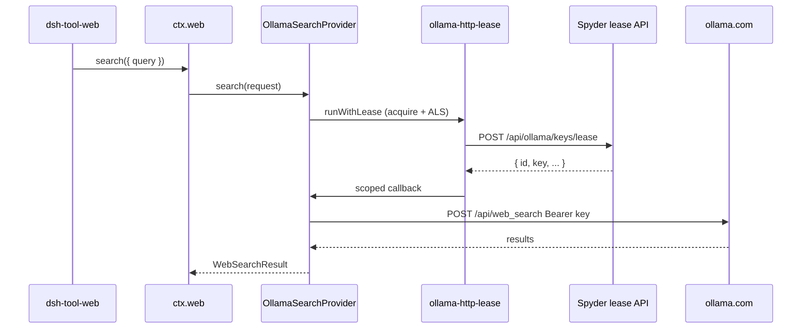

# Research: та же HTTP lease-схема для `@mikhail/dsh-web-search-ollama`

## Тип задачи

FEATURE / gap closure (не дефект lease-плагина в узком смысле: LLM-path сделан по ТЗ; **web_search — отдельный seam**).

## Симптом (эксплуатация)

- `@mikhail/dsh-ollama-redis-lease`: на `llm/stream` + `provider: ollama` ключ из Spyder lease; `OLLAMA_API_KEY` в `.env` можно убрать — чат работает.
- `@mikhail/dsh-web-search-ollama`: при закомментированном `OLLAMA_API_KEY` поиск **недоступен** (`available() === false` или 401), хотя lease для LLM живой.
- Пока в `.env` остаётся **один** статический ключ — **все** `web_search` ходят в Ollama Cloud с ним; пул ключей на поиск **не применяется**.

Ожидание продукта: **каждый** исходящий вызов Ollama Cloud (LLM **и** `POST /api/web_search`) берёт ключ через lease, без отдельного «вечного» `OLLAMA_API_KEY` для поиска.

---

## Корневая причина

### Два разных пути к Ollama

| Поверхность | Seam | Как берётся ключ сегодня | Lease сегодня |
|-------------|------|---------------------------|---------------|
| Чат / agent loop | `ctx.llm` → morlay `stream()` → `credentials.resolve(OLLAMA_API_KEY)` | resolve + ALS во время stream | **Да** (`dsh-ollama-redis-lease`) |
| `web_search` tool | `ctx.web.search()` → `OllamaSearchProvider.search()` | `launchEnvironmentOf(ctx).get(apiKeyEnv)` **один раз в `apply()`** | **Нет** |

### Код web-search (факт)

Источник в профиле: `~/.dsh/profiles/web/node_modules/@mikhail/dsh-web-search-ollama/lib/` (в git репозитории harness пока только README/package.json в `plugins/dsh-web-search-ollama/`, без `lib/`).

`apply()`:

```javascript
const apiKey = config.apiKey ?? launchEnvironmentOf(ctx).get(config.apiKeyEnv)?.value ?? ''
const provider = new OllamaSearchProvider({ apiKey, baseURL, ... })
ctx.web.registerSearchProvider(provider)
```

`OllamaSearchProvider`:

- `available()` → `apiKey.length > 0` (локально, без сети).
- `search()` → `Authorization: Bearer ${this.options.apiKey}` (значение **заморожено** при старте).

**Не используется:** `ctx.credentials`, `llm/stream`, ALS, HTTP lease.

### Почему «просто вызвать credentials.resolve» в search недостаточно

`dsh-ollama-redis-lease` подменяет `resolve(OLLAMA_API_KEY)` только когда в `AsyncLocalStorage` есть активный lease (выставляется в hook **`llm/stream`**). Вызов `credentials.resolve` из `web.search()` **вне** этого scope при `allowStaticFallback: false` → `undefined` → Bearer пустой / поиск падает.

Значит для web нужны **оба** шага на каждый search (или на батч — см. ниже):

1. `POST` lease (как у LLM).
2. `enterActiveLease` → `resolve` / прямое использование `lease.secret` → `fetch /api/web_search`.

### Upstream: нет hook на `web.search`

`@deepseek-ai/dsh-web` (`packages/web/web/src/index.ts`): `search()` сразу вызывает `provider.search()`; **waterfall / intercept для web нет** (в отличие от `llm/stream`). Расширять harness `packages/web` ради lease — большой blast radius; для личного стека достаточно правок **out-of-tree** плагинов.

---

## Поток данных (целевой)



---

## Варианты интеграции

### A. Расширить только `dsh-ollama-redis-lease` (обёртка провайдера)

Идея: после загрузки дернуть зарегистрированный `ollama` search provider и заменить `search` на обёртку с acquire.

**Минусы:** реестр `ctx.web` приватный; без API harness подмена только через fork `registerSearchProvider` или дублирование провайдера → **неприемлемо**.

**Вердикт:** отклонить.

### B. Править только `dsh-web-search-ollama` (дублировать lease HTTP)

Идея: в провайдере `keyMode: lease`, свой `LeaseApiClient`, те же env что у lease-плагина.

**Минусы:** два места с контрактом Spyder, расхождение retry/TLS/логов.

**Вердикт:** только как временный костыль; не SSOT.

### C. Сервис `ctx.provide` из lease-плагина + потребление в web-search (рекомендуется)

Паттерн как `dsh-telegram-voice` → `telegramStt`.

1. **`dsh-ollama-redis-lease`** (или выделенный маленький пакет `@mikhail/dsh-ollama-lease-core`):
   - Вынести `LeaseApiClient`, `enterActiveLease`, `runWithOllamaLease(async () => { ... })` в общий модуль.
   - `ctx.provide('ollamaHttpLease', { runWithLease })` — один acquire на scope, ALS, логи `acquired id=`.

2. **`dsh-web-search-ollama`**:
   - `inject: ['web', 'ollamaHttpLease']` (optional: если сервиса нет — старое поведение env/static).
   - `available()`: true если есть static key **или** зарегистрирован `ollamaHttpLease` и в env есть `OLLAMA_LEASE_TOKEN` (не `OLLAMA_API_KEY`).
   - `search()`: `return ollamaHttpLease.runWithLease(() => fetchWithKey(await resolveKey()))`, где `resolveKey` = `credentials.resolve(OLLAMA_API_KEY)` **внутри** scope (переиспользует существующий `patchCredentialsResolve`).

3. **Порядок bundle:** `@mikhail/dsh-ollama-redis-lease` **до** `@mikhail/dsh-web-search-ollama` (provide до inject).

4. **Конфиг:** в web-search опционально `credentialRef: OLLAMA_API_KEY` (как у morlay), без дублирования URL lease в двух YAML — lease остаётся только в lease-плагине.

**Плюсы:** один HTTP-клиент, один ALS/credentials delegate, явный контракт, без правок upstream.

**Минусы:** нужен согласованный **имя слота** `provide`/`inject` (документировать в README обоих плагинов).

### D. Per-search `credentials` без provide (web-search сам вызывает lease)

Web-search тянет `@mikhail/dsh-ollama-redis-lease` как dependency и импортирует `LeaseApiClient` + `enterActiveLease`.

**Минусы:** жёсткая связь пакетов; двойной `patchCredentialsResolve` если оба плагина патчат credentials.

**Вердикт:** хуже C; если C — использовать общий `lib/` через workspace path или мини-пакет `ollama-lease-core`.

### E. Upstream: waterfall `web/search` в `@deepseek-ai/dsh-web`

Как `llm/stream`: lease-плагин только слушает событие.

**Плюсы:** чистая архитектура для всех search-провайдеров.

**Минусы:** изменение vendored harness, Agent Note, тесты — **не для текущего личного стека** без явного запроса на upstream.

---

## Параллельность и `web_search` tool

`@deepseek-ai/dsh-tool-web` может запускать **несколько** запросов за один tool call (`searchMaxQueries` до 4). Каждый вызов `ctx.web.search()` — отдельный `provider.search()`.

**Рекомендация v1:** **один lease на один `search()`** (как один lease на один `llm/stream`). При multi-query в одном tool call — до 4 lease подряд; это соответствует цели «не шарить один ключ на всё» и совпадает с lock на Spyder (`lock_seconds`).

Опционально v2: один lease на весь tool call (сложнее: нужен hook на уровне tool-web, не только провайдера).

---

## `available()` после отключения `OLLAMA_API_KEY`

Сейчас пустой env → провайдер **не регистрируется как usable** → `WEB_PROVIDER_UNAVAILABLE` до первого запроса.

После интеграции:

- `available()` должно учитывать **lease token** (`OLLAMA_LEASE_TOKEN` / config `lease.tokenEnv` из lease-плагина не дублировать в web-search — достаточно «есть `ollamaHttpLease`»).
- Статический `OLLAMA_API_KEY` — **legacy fallback** (config `allowStaticFallback` симметрично lease-плагину или только через credentials при отсутствии provide).

---

## Список файлов для реализации (черновик)

| Путь | Действие |
|------|----------|
| `plugins/dsh-ollama-redis-lease/lib/lease-scope.js` | NEW: `runWithOllamaLease(leaseClient, logger, fn)` |
| `plugins/dsh-ollama-redis-lease/lib/index.js` | `ctx.provide('ollamaHttpLease', …)`; LLM bridge вызывает тот же scope |
| `plugins/dsh-web-search-ollama/lib/` | SYNC из node_modules + правки provider/index |
| `plugins/dsh-web-search-ollama/lib/provider.js` | per-request key внутри `runWithLease` |
| `plugins/dsh-web-search-ollama/lib/index.js` | `inject` optional lease; `available()` |
| `~/.dsh/profiles/web/package.json` | bundle order: lease **перед** web-search |
| `doc/plugins/dsh-ollama-redis-lease/web-search-lease/design.md` | следующая фаза |
| Тесты | unit: mock lease + mock fetch; integration: credentials delegate + search |

---

## Риски и открытые вопросы

1. **Имя `ctx.provide`:** зафиксировать (`ollamaHttpLease` vs `ollamaLease`) и тип контракта в JSDoc.
2. **401 на web_search:** карантин на Spyder; DSH не делает release — поведение как у LLM (повторный lease на следующий вызов).
3. **Синхронизация исходников:** перенести `lib/` web-search в `plugins/dsh-web-search-ollama/` репозитория harness, чтобы не править только `node_modules`.
4. **Переименование пакета** `dsh-ollama-redis-lease` — по-прежнему опционально; на web-search не влияет.

---

## Итог

Это **архитектурный разрыв scope**, а не поломка lease для LLM: web-search читает env **при старте** и не входит в ALS/`llm/stream`. Рекомендуемый путь — **вариант C**: общий `runWithOllamaLease` + `ctx.provide`, доработка `dsh-web-search-ollama` для per-`search()` acquire и resolve внутри scope; upstream `dsh-web` не трогать.

Связанные документы: [[repo/doc/plugins/dsh-ollama-redis-lease/research.md]], [[repo/doc/plugins/dsh-ollama-redis-lease/design.md]], README `plugins/dsh-web-search-ollama/README.md`.
