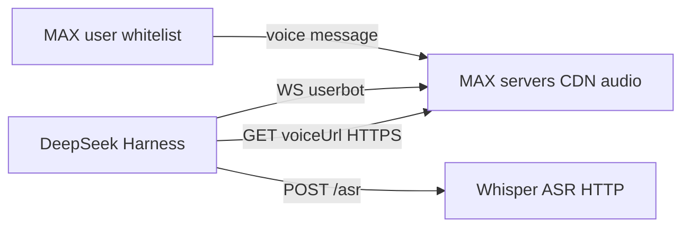
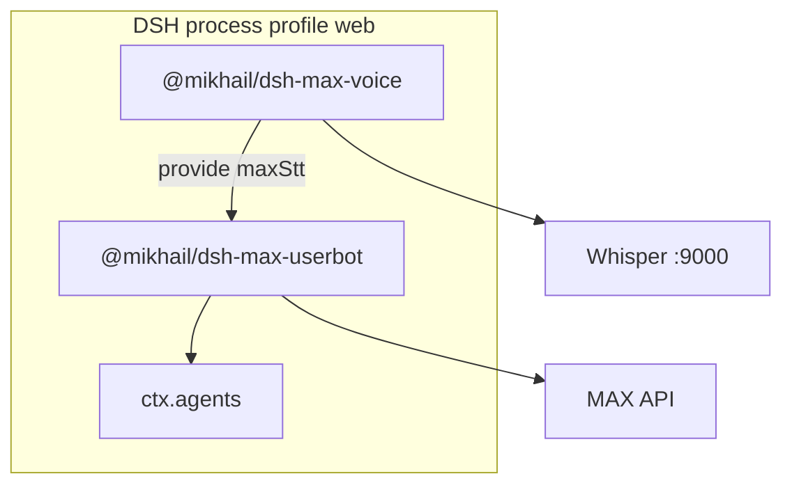
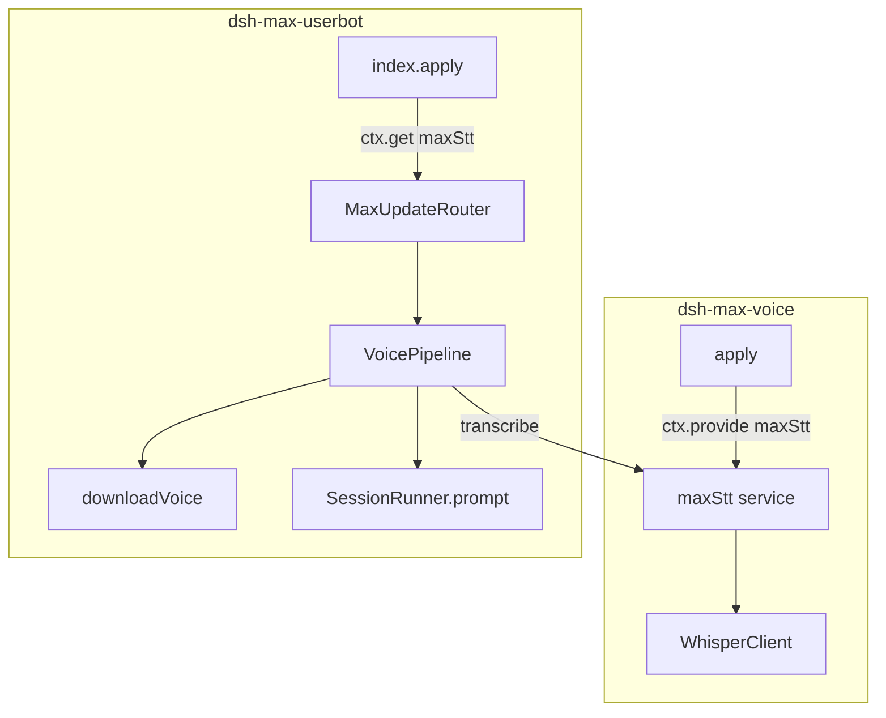
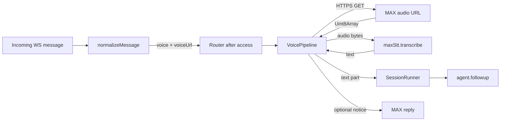
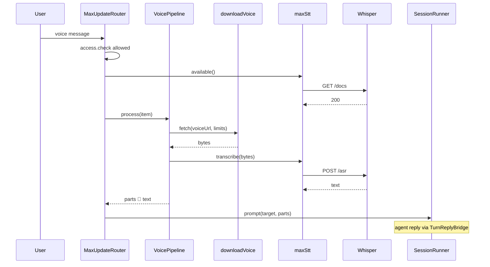
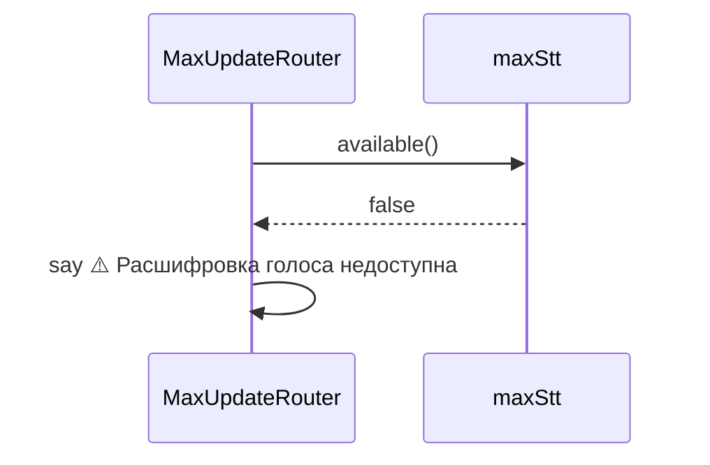
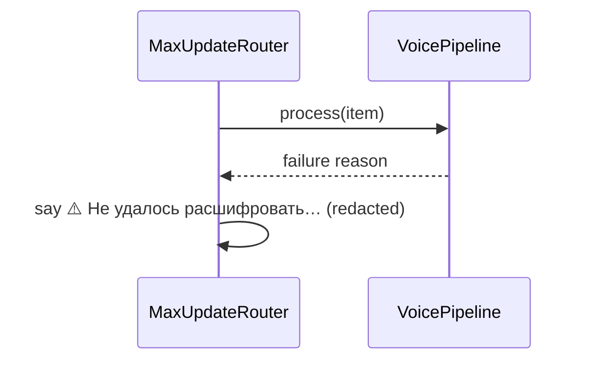

# Architecture Design: MAX voice → STT → agent

SSOT: [[repo/doc/plugins/max-voice-stt/research]], [[repo/doc/plugins/dsh-max-userbot/tz]] §9, [[repo/doc/plugins/dsh-max-userbot/design]] §9.

**Итог для пользователя:** голосовое в MAX распознаётся тем же Whisper, что Telegram (`localhost:9000` в профиле `web`), текст уходит в тот же harness-session для этого MAX-чата; при недоступном STT — понятное сообщение, процесс DSH не падает.

---

## 1. Контекст системы (C4 — Level 1)

---

## 2. Контейнеры (C4 — Level 2)

`@mikhail/dsh-telegram-voice` остаётся независимым (`telegramStt`); общий только деплой Whisper, не Cordis-слот.

---

## 3. Компоненты (C4 — Level 3)

**VoicePipeline** — чистая оркестрация: validate URL → download → transcribe → `{ parts, userNotice? }` (аналог `transcribeVoice` в telegram `collect.js`, без Telegram file API).

---

## 4. Потоки данных (DFD)

---

## 5. Диаграмма последовательности

### 5.1 Успех

### 5.2 STT недоступен

### 5.3 Ошибка download / transcribe

---

## 6. Архитектурные решения (ADR)

### ADR-001: Отдельный плагин `@mikhail/dsh-max-voice` и слот `maxStt`

- **Статус:** Accepted
- **Контекст:** ТЗ требует `maxStt`; `telegramStt` уже занят telegram-плагином; смешивать имена ломает границы bundle.
- **Решение:** Новый пакет `plugins/dsh-max-voice/` по образу `dsh-telegram-voice`: `ctx.provide('maxStt', { available, transcribe })`, тот же HTTP-контракт Whisper (`WhisperClient` — копия или общий файл в пакете, без зависимости от `dsh-telegram-voice`).
- **Последствия:** Два patch в профиле с одинаковым `baseURL` (допустимо); дублирование ~100 строк клиента; независимое отключение MAX STT.

### ADR-002: Синхронный Whisper, не MAX `transcribeMedia` (op 202)

- **Статус:** Accepted
- **Контекст:** Vendor умеет server-side transcription через push op 293; в transport плагина нет подписки на push-транскрипт.
- **Решение:** Скачать байты по `voiceUrl` → `maxStt.transcribe`, как Telegram.
- **Последствия:** Предсказуемая латентность в одном turn; не зависим от MAX push; нужен рабочий CDN URL в attach.

### ADR-003: Скачивание через `downloadFile` vendor + лимиты в config userbot

- **Статус:** Accepted
- **Контекст:** Research: `downloadFile` в vendored `max-account-api`; design v1 MAX требовал size cap и timeout.
- **Решение:** Обёртка `downloadVoice(url, { maxBytes, timeoutMs, signal })` в `dsh-max-userbot`: только `https:` URL (parse `URL`), `fetch` с `AbortSignal`, проверка `Content-Length` если есть, иначе накопление с отсечением по `maxBytes`.
- **Последствия:** Защита от SSRF на `http:` / file; большие файлы отклоняются до Whisper.

### ADR-004: Текст в агент как в Telegram

- **Статус:** Accepted
- **Контекст:** Единообразие фронтов.
- **Решение:** Один block `{ type: 'text', text: '🎤 ' + transcript }`; опциональный caption из `item.text` если пользователь добавил текст к голосу (редко) — prefix как в `collect.js`.
- **Последствия:** Модель видит маркер голоса в логе.

### ADR-005: Опциональный `maxStt` — soft fail

- **Статус:** Accepted
- **Контекст:** Плагин userbot должен стартовать без voice bundle.
- **Решение:** `index.js`: `const stt = ctx.get('maxStt')`; router получает `stt` в options; нет сервиса или `available() === false` → пользовательские строки как в telegram (RU), без throw из `apply`.
- **Последствия:** Старый stub заменяется на «расшифровка недоступна» если bundle не подключён.

### ADR-006: Конфигурация

- **Статус:** Accepted
- **Контекст:** Tunables не в коде (AGENTS.md).
- **Решение:**
  - `dsh-max-voice` Config: `baseURL`, `language`, `timeoutMs` (как telegram-voice).
  - `dsh-max-userbot` Config: `voice.maxBytes` (default **20_000_000**), `voice.downloadTimeoutMs` (default **60_000**), `voice.mimeType` (default **`audio/ogg`** для Whisper).
- **Последствия:** Оператор правит patch профиля, не форк плагина.

---

## 7. Чистая архитектура (слои)

| Слой | Элементы |
|------|----------|
| **Domain / use case** | «Принять голос MAX → текст для агента» (`VoicePipeline`) |
| **Ports** | `maxStt` (Cordis), лимиты из `Config` |
| **Adapters** | `downloadVoice` (fetch), `WhisperClient`, `MaxUpdateRouter` |
| **Framework** | Cordis `apply`, `provide`, `get` |

Зависимости: Router → VoicePipeline → (download + maxStt); не тянуть Whisper в router напрямую.

---

## 8. План тестирования

| Тип | Сценарии |
|-----|----------|
| Unit | `assertAllowedVoiceUrl` — https ok, http/file reject |
| Unit | `downloadVoice` — mock `fetch`: ok body, timeout, over maxBytes, bad status |
| Unit | `VoicePipeline` — mock stt: success, empty transcript, transcribe throw |
| Unit | `MaxUpdateRouter` — voice + stt mock → `runner.prompt` called with 🎤; no stt → RU unavailable |
| Unit | `dsh-max-voice` — `available` / `transcribe` with mock fetch (как минимум smoke) |
| Integration | self-skip: real Whisper + real MAX (manual runbook) |

**Coverage:** ≥ **80%** по новым/изменённым файлам `plugins/dsh-max-voice/lib/**` и `plugins/dsh-max-userbot/lib/voice/**` + затронутые ветки `router.js` (исключения как в пакете userbot: `vendor/**`, `index.js` transport — без изменения политики).

---

## 9. Безопасность

- **Authz:** без изменений — голос только после `PhoneWhitelistPolicy` (как текст).
- **SSRF:** только `https:` для `voiceUrl`; отклонять отсутствующий/невалидный URL.
- **DoS:** `maxBytes` + `downloadTimeoutMs`; не передавать в Whisper пустые/гигантские буферы.
- **Секреты:** Whisper URL только в `cordis.patch.yml` профиля; не в репозитории.
- **Логи:** не логировать полный `voiceUrl` с query-токенами на `info` (допустимо `debug` обрезанный); транскрипт — только `debug` как в telegram-voice.
- **XSS:** ответы MAX — plain text.
- **Валидация:** schemastery на Config обоих плагинов.

---

## 10. Риски и компромиссы

- Дублирование `WhisperClient` между telegram-voice и max-voice (общий пакет — отдельная задача).
- Формат аудио с CDN может отличаться от OGG; default mime `audio/ogg`, при ошибках Whisper — уточнить по smoke.
- Нет прогресса «распознаём…» в MAX v1 (один ответ после turn); typing indicator — v2.
- `pnpm file:` копия плагина без vendor `dist` — операторский runbook без изменения логики voice.

---

## 11. Implementation checklist (для Plan Mode)

1. Создать `plugins/dsh-max-voice/`: `package.json`, `cordis.patch.yml`, `lib/config.js`, `lib/whisper-client.js` (из telegram-voice), `lib/index.js` → `maxStt`.
2. Обновить `plugins/README.md`: строка пакета, bundle order **`@mikhail/dsh-max-voice` before `@mikhail/dsh-max-userbot`**.
3. `plugins/dsh-max-userbot/lib/config.js` — секция `voice` (maxBytes, downloadTimeoutMs, mimeType).
4. `plugins/dsh-max-userbot/lib/voice/download.js` — HTTPS + limited fetch.
5. `plugins/dsh-max-userbot/lib/voice/pipeline.js` — orchestration + сообщения пользователю (RU, как telegram).
6. `plugins/dsh-max-userbot/lib/index.js` — `ctx.get('maxStt')`, передать в `MaxUpdateRouter`.
7. `plugins/dsh-max-userbot/lib/router.js` — заменить stub voice на `handleVoice` → pipeline → `runPrompt`.
8. Тесты: `test/voice-download.test.js`, `test/voice-pipeline.test.js`, обновить `test/router-commands.test.js`.
9. `plugins/dsh-max-voice/test/whisper-client.test.js` (mock fetch) — опционально минимум.
10. Doc: `doc/plugins/dsh-max-userbot/runbook-local.md` — smoke голос + Whisper; ссылка из [[repo/doc/plugins/max-voice-stt/design]].
11. Оператор (вне коммита репо): `~/.dsh/profiles/web` — dep + bundle `dsh-max-voice`, patch config, `pnpm install`, restart DSH.
